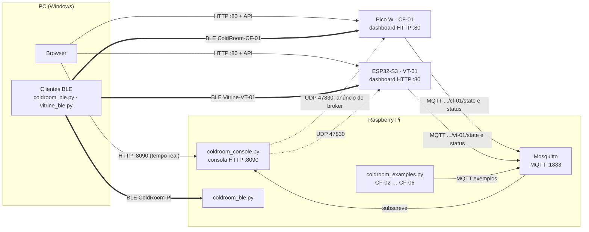

# ColdRoom SIM — Câmara frigorífica (Pico W) e vitrine expositora (ESP32-S3) virtuais

O **Pico W é o simulador** de uma única câmara frigorífica **CF-01**. Não necessita de sensores, relés nem PLC. Executa autonomamente um modelo simplificado de refrigeração, gera dados e alarmes fictícios e disponibiliza um site local com controlos de cenário.

O sistema completo tem três equipamentos na mesma rede Wi-Fi:

| Equipamento | Papel | Pasta | Nome BLE |
|---|---|---|---|
| Raspberry Pi Pico W | Câmara frigorífica **CF-01** (talho) | esta pasta | `ColdRoom-CF-01` |
| ESP32-S3 Supermini | Vitrine expositora **VT-01** (lacticínios, plug-in R290) | `Vitrine-ESP32/` | `Vitrine-VT-01` |
| Raspberry Pi | Broker MQTT (Mosquitto) e consola central (porta 8090) | `coldroom-console/` | `ColdRoom-Pi` |

O Pico e o ESP32 publicam no broker do Raspberry Pi e aparecem juntos na consola.

## Ligações

Os três equipamentos e o PC estão na mesma rede Wi-Fi (2,4 GHz). O Bluetooth só serve para configurar as redes Wi-Fi.



Setas contínuas: Wi-Fi. Tracejadas: anúncio UDP em broadcast. Duplas: Bluetooth LE.

| Ligação | Protocolo e porta | Para quê |
|---|---|---|
| Pico W / ESP32 → Mosquitto | MQTT 1883 (QoS 0, sem TLS) | Estado de 5 em 5 s (`…/state`, retido) e `online`/`offline` (`…/status`, last will) |
| `coldroom_examples.py` → Mosquitto | MQTT 1883 | Câmaras de exemplo CF-02 a CF-06, no mesmo formato do Pico |
| Mosquitto → consola | MQTT 1883 (no próprio Pi) | A consola subscreve todos os tópicos e guarda o estado e o histórico |
| Consola → Pico W / ESP32 | UDP 47830, broadcast de 5 em 5 s | Anuncia o IP do broker, usado quando a rede não tem `mqtt_host` ou o broker falha 2 vezes |
| Browser → consola | HTTP 8090 | Todos os equipamentos numa página, atualizada em tempo real |
| Browser → Pico W / ESP32 | HTTP 80 (`/`, `/api/state`, `/api/action`) | Dashboard de cada simulador e controlo dos cenários e avarias |
| PC → Pico W / ESP32 / Pi | Bluetooth LE | Adicionar, listar e remover redes Wi-Fi (só nas janelas em que o BLE está ativo) |

## Ficheiros

- `main.py`: servidor HTTP, Wi-Fi e API JSON
- `simulator.py`: dinâmica simulada e injeção de falhas
- `mqtt_pub.py`: cliente MQTT mínimo (publicação QoS 0, com timeout)
- `location.py`: localização do equipamento (país/zona/loja/local/equipamento) a partir do `config.py`
- `netcfg.py`: redes Wi-Fi conhecidas (config.py + networks.json) e escolha da melhor
- `ble_setup.py`: configuração por Bluetooth LE
- `desktop/coldroom_ble.py`: cliente no PC para configurar redes do Pico e do Raspberry Pi por Bluetooth
- `index.html`: dashboard standalone (HTML, CSS, JavaScript; sem CDN)
- `config.example.py`: modelo de configuração Wi-Fi
- `config.py`: configuração Wi-Fi real (não partilhar)
- `desktop/preview.py`: simulação local no PC para testar antes de copiar
- `tests/test_simulator.py`: verificações da dinâmica e alarmes

## Visual Studio Code: testar sem Pico

```powershell
py desktop/preview.py
```

Abre http://127.0.0.1:8766 . O PC executa o mesmo motor de simulação do Pico. Python 3.8+; sem dependências para a pré-visualização.

## Instalar no Pico W

1. Instalar a versão **estável do MicroPython própria do Pico W**: https://micropython.org/download/RPI_PICO_W/ .
2. Nesta pasta, copiar `config.example.py` para `config.py` e editar SSID e password da rede **2,4 GHz**.
3. No terminal VS Code: `py -m pip install mpremote`.
4. Com o Pico ligado (substituir COM7 pela porta real), executar:

```powershell
mpremote connect COM7 cp config.py :config.py
mpremote connect COM7 cp simulator.py :simulator.py
mpremote connect COM7 cp index.html :index.html
mpremote connect COM7 cp mqtt_pub.py :mqtt_pub.py
mpremote connect COM7 cp location.py :location.py
mpremote connect COM7 cp netcfg.py :netcfg.py
mpremote connect COM7 cp ble_setup.py :ble_setup.py
mpremote connect COM7 cp main.py :main.py
mpremote connect COM7 reset
```

5. Para ver o IP e mensagens: `mpremote connect COM7` (ou consultar no router). Aceder a `http://IP_DO_PICO/`.

**Importante**: guardar `main.py` no Pico faz arrancar o simulador automaticamente após reiniciar.

## Vitrine expositora no ESP32-S3 (subpasta `Vitrine-ESP32`)

A pasta `Vitrine-ESP32/` é um simulador diferente: uma vitrine de supermercado **VT-01** com 3 portas de vidro, unidade plug-in a R290, produtos lácteos a +3 °C. Tem README próprio (`Vitrine-ESP32/README.md`) com o modelo, as avarias e a API completos. Publica no mesmo broker e aparece na mesma consola do Raspberry Pi.

**O que partilha com o Pico:** `mqtt_pub.py`, `location.py`, `netcfg.py` e `ble_setup.py` (ficheiros iguais), o formato do `config.py` (`WIFI_NETWORKS`, `MQTT_*`, `LOCATION_*`), a mudança automática de rede e a descoberta do broker. Os campos comuns do JSON têm os mesmos nomes, por isso a consola mostra a vitrine sem alterações (`type` vale `"vitrine"`).

**O que é próprio:** `simulator.py` (classe `Showcase`: termostato liga/desliga, degelo por paragem, horário da loja, clientes que abrem as portas, sonda de produto HACCP, anti-embaciamento, iluminação LED), `index.html` e `board.py` (LED RGB WS2812 no GPIO48 e botão BOOT no GPIO0).

| | Pico W (CF-01) | ESP32-S3 (VT-01) |
|---|---|---|
| Firmware | MicroPython `RPI_PICO_W` | MicroPython `ESP32_GENERIC_S3` (v1.29.0) |
| Envio dos ficheiros | MicroPico ou `mpremote` | `mpremote` ou tarefa do VS Code *Vitrine: enviar para o ESP32* |
| Ativar BLE à mão | BOOTSEL premido 1 s | BOOT premido 1 s |
| Indicador BLE | LED da placa aceso | LED RGB junto ao chip, azul fixo |
| Tópico MQTT | `pt/norte/porto-boavista/talho/cf-01/…` | `pt/norte/porto-boavista/lacticinios/vt-01/…` |
| Identificador MQTT | `ColdRoom-SIM-01` | `Vitrine-SIM-01` (tem de ser diferente) |
| Pré-visualização no PC | http://127.0.0.1:8766 | http://127.0.0.1:8767 |
| Cliente BLE no PC | `desktop\coldroom_ble.py` | `Vitrine-ESP32\desktop\vitrine_ble.py` |
| Extras | — | Watchdog (30 s), `reset_cause`, temperatura do chip, CPU a 160 MHz |

**Instalação resumida** (detalhes no README da pasta; substituir COM16 pela porta real):

```powershell
cd Vitrine-ESP32
copy config.example.py config.py        # editar rede Wi-Fi e IP do broker
py -m mpremote connect COM16 cp simulator.py mqtt_pub.py location.py netcfg.py ble_setup.py board.py index.html config.py main.py : + reset
```

- A porta COM muda depois de gravar o MicroPython (confirmar com `py -m mpremote connect list`).
- O MicroPico ignora a pasta `Vitrine-ESP32` (não é enviada para o Pico) e, se estiver ligado, ocupa a porta: desligá-lo antes de usar o `mpremote` no ESP32.
- O LED azul a piscar junto ao USB-C ("BAT") é do carregador de bateria e é normal sem bateria ligada.

## O que simula

- Câmara, ar insuflado, ar de retorno, evaporador/degelo, setpoint
- Compressor com capacidade percentual, ventiladores e válvula de expansão eletrónica
- Pressões de aspiração/descarga, superaquecimento e subarrefecimento **sintéticos**
- Tensão trifásica, corrente, potência, energia e horas de funcionamento simuladas
- Ciclo de degelo, porta aberta, falha de fase, óleo baixo, refrigerante baixo e alta pressão
- Proteção latched do compressor, rearmar falhas e reiniciar cenários
- Alarmes de temperatura: **TEMPERATURA ALTA** (setpoint + 4 °C) e **TEMPERATURA BAIXA** (setpoint − 3 °C) ao fim de 10 min simulados, fora do degelo (o mesmo critério da vitrine)
- Histórico de temperaturas e eventos, aceleração do tempo 1x, 5x e 20x

A lógica é didática: uma porta aberta aumenta a carga térmica; o compressor responde ao setpoint com histerese; durante degelo a refrigeração pára; falhas críticas provocam bloqueio até remover a falha e rearmar. Algumas variáveis são estimativas artificiais para formação, não modelos termodinâmicos ou leituras de sensores. Os limiares são demonstrativos e não devem ser usados para conformidade HACCP ou controlo físico.

## API

- `GET /api/state` → estado JSON completo
- `POST /api/action` → objeto JSON com comandos, como:

```json
{"action":"setpoint","value":2.0}
{"action":"ambient","value":28}
{"action":"speed","value":20}
{"action":"door","value":true}
{"action":"fault","name":"phase_fault","value":true}
{"action":"defrost"}
{"action":"reset"}
{"action":"restart"}
```

## MQTT

O Pico publica o estado no broker definido em `config.py` (`MQTT_HOST`, porta 1883; nos exemplos abaixo o Raspberry Pi está em `192.168.1.50`):

| Tópico | Conteúdo | Retido |
|---|---|---|
| `pt/norte/porto-boavista/talho/cf-01/state` | JSON igual a `/api/state` (sem `history` nem `events`) mais `location`; de `MQTT_INTERVAL` em `MQTT_INTERVAL` segundos (5 s) | sim |
| `pt/norte/porto-boavista/talho/cf-01/status` | `online` ao ligar; `offline` (last will) se o Pico desaparecer | sim |

O tópico é montado a partir dos campos `LOCATION_*` do `config.py`, no formato **país/zona/loja/localização/equipamento**:

| Nível | Campo | Valor (fictício) |
|---|---|---|
| País | `LOCATION_COUNTRY` | `pt` |
| Zona | `LOCATION_ZONE` | `norte` |
| Loja | `LOCATION_STORE` | `porto-boavista` |
| Localização na loja | `LOCATION_AREA` | `talho` |
| Equipamento | `LOCATION_EQUIPMENT` | `cf-01` |

Os valores são convertidos para minúsculas, e espaços ou `/ # +` passam a `-`. Os mesmos campos seguem no JSON em `location` (MQTT e `/api/state`) e aparecem no dashboard, por baixo do nome do equipamento, junto com o tópico MQTT e o estado da ligação ao broker.

Ver as mensagens a partir de outra máquina (os wildcards permitem filtrar por nível):

```bash
mosquitto_sub -h 192.168.1.50 -t 'pt/norte/porto-boavista/talho/cf-01/#' -v     # este equipamento
mosquitto_sub -h 192.168.1.50 -t 'pt/norte/porto-boavista/#' -v       # tudo da loja
mosquitto_sub -h 192.168.1.50 -t 'pt/+/+/talho/+/state' -v            # todos os talhos do país
mosquitto_sub -h 192.168.1.50 -t '+/+/+/+/+/status' -v                # estado online/offline de todos
```

- Se o broker estiver em baixo, o simulador e o dashboard continuam a funcionar; o Pico tenta voltar a ligar de 15 em 15 s (ver mensagens `MQTT erro:` na consola série).
- O `offline` aparece cerca de 45 s depois de o Pico ser desligado (1,5 × keepalive).
- Se o Mosquitto exigir autenticação, preencher `MQTT_USER` e `MQTT_PASSWORD`. Para desativar o MQTT, apagar a linha `MQTT_HOST`.

## Redes Wi-Fi e Bluetooth (Pico W e Raspberry Pi)

Para usar o simulador noutra rede **sem ligar o Pico ao PC**, as redes configuram-se por Bluetooth LE.

**Várias redes no Pico.** O Pico liga-se à rede conhecida com melhor sinal. Cada rede tem o
IP do Raspberry Pi (broker) nessa rede:

- predefinidas no `config.py` → `WIFI_NETWORKS = [{'ssid': ..., 'password': ..., 'mqtt_host': ...}]`
- adicionadas por Bluetooth → guardadas no Pico em `networks.json`

O Raspberry Pi também guarda várias redes (wpa_supplicant) e liga-se à que estiver disponível.

**Quando o Bluetooth está ativo**

| | Nome BLE | Janela |
|---|---|---|
| Pico W | `ColdRoom-CF-01` (equipamento do `config.py`) | 3 min após arrancar · 5 min sem rede conhecida · **BOOTSEL premido 1 s** (LED aceso = BLE ativo) |
| Raspberry Pi | `ColdRoom-Pi` | 10 min após arrancar · sempre que não tem Wi-Fi |

**Cliente no PC** (Windows com Bluetooth; uma vez: `py -m pip install bleak`):

```powershell
py desktop\coldroom_ble.py scan                      # equipamentos com BLE ativo
py desktop\coldroom_ble.py pi status                 # rede e IP atuais do Pi
py desktop\coldroom_ble.py pi list
py desktop\coldroom_ble.py pi add --ssid "RedeLoja"  # pede a password
py desktop\coldroom_ble.py pico add --ssid "RedeLoja" --mqtt-host 192.168.1.50
py desktop\coldroom_ble.py pico list
py desktop\coldroom_ble.py pico remove --ssid "RedeLoja"
py desktop\coldroom_ble.py pico apply                # reinicia o Pico para usar as redes novas
py desktop\coldroom_ble.py pi apply                  # wpa_cli reconfigure (o Pi pode mudar de rede/IP)
```

Com vários Picos, escolhe-se pelo nome: `--name ColdRoom-CF-02`.

**Levar o simulador para outra rede (antes de sair)**

1. `pi add --ssid "RedeNova"`: o Pi fica a conhecer a rede (a ligação atual mantém-se).
2. No local, quando o Pi não encontrar redes conhecidas abre o BLE sozinho; também se pode
   usar `pi add`/`pi apply` no local. Depois `pi status` mostra o IP novo do Pi.
3. `pico add --ssid "RedeNova" --mqtt-host <IP do Pi>` e `pico apply`
   (no local, sem rede conhecida o Pico abre o BLE sozinho; senão BOOTSEL 1 s).

Se o IP do Pi for desconhecido antes de chegar, adiciona-se a rede ao Pico já no local, depois de `pi status`.

**Segurança:** o BLE **não é cifrado** (limitação do MicroPython RP2); a password Wi-Fi passa em
claro e fica em texto no `networks.json` do Pico. No Pi guarda-se só a PSK derivada. As janelas
curtas reduzem a exposição. Usar apenas em laboratório, com redes de teste.

### Exemplo: rede preferida e rede de reserva

Exemplo genérico com duas redes (substituir pelos nomes, passwords e IPs reais no `config.py` de cada equipamento):

| Equipamento | `RedeLab` (preferida, IP fixo) | `RedeReserva` (reserva, DHCP) |
|---|---|---|
| Raspberry Pi (broker e consola) | 192.168.10.15 (`/etc/dhcpcd.conf`, bloco `ssid`) | 192.168.1.50 (reserva DHCP no router) |
| Pico W (CF-01) | 192.168.10.16 | atribuído pelo router |
| ESP32-S3 (VT-01) | 192.168.10.17 | atribuído pelo router |

```python
WIFI_NETWORKS = [
    {'ssid': 'RedeReserva', 'password': '...', 'mqtt_host': '192.168.1.50', 'priority': 1},
    {'ssid': 'RedeLab', 'password': '...', 'mqtt_host': '192.168.10.15',
     'ip': '192.168.10.16/24', 'gw': '192.168.10.1', 'priority': 2},   # Pico .16, ESP32 .17
]
```

- Router da `RedeLab`: 192.168.10.1 (/24). A prioridade tem de ser a mesma nos três equipamentos (`RedeLab` 2, `RedeReserva` 1), para nunca ficarem em redes diferentes.
- No `config.py`, cada rede pode ter `ip` (IP fixo), `gw`, `priority` e `mqtt_host`.
- **Mudança automática de rede:** se o Wi-Fi cair mais de 30 s, o equipamento reinicia e liga-se à melhor rede disponível (sem a preferida, vai para a de reserva). Se estiver na rede de reserva, de 5 em 5 min procura a preferida e, se a vir, reinicia para voltar a ela. O Pi faz o mesmo de 2 em 2 min com o `coldroom-wifi-prefer.timer` (pasta `coldroom-console`).
- **Descoberta do broker:** a consola do Pi anuncia o broker por UDP (porta 47830) de 5 em 5 s. Numa rede sem `mqtt_host`, ou se o broker falhar 2 vezes, o Pico e o ESP32 usam o IP desse anúncio.

## Segurança e limitações

- **Apenas simulação**: não controla cargas elétricas, compressores, válvulas nem sistemas físicos.
- HTTP **sem TLS e sem autenticação**; usar apenas rede isolada de laboratório, sem exposição à Internet.
- As credenciais Wi-Fi ficam guardadas em texto simples no `config.py` do Pico; não partilhar esse ficheiro.
- Bluetooth LE sem cifra (só em janelas curtas) e MQTT sem TLS (porta 1883); usar apenas em rede local.
- O histórico está em RAM (até 80 amostras) e perde-se após reinício; não é um registo auditável.
- Os dados de temperatura, energia, pressão e alarms não são medições reais. Nunca usar para conformidade alimentar ou decisões operacionais.

## Testes

```powershell
py tests/test_simulator.py
```
